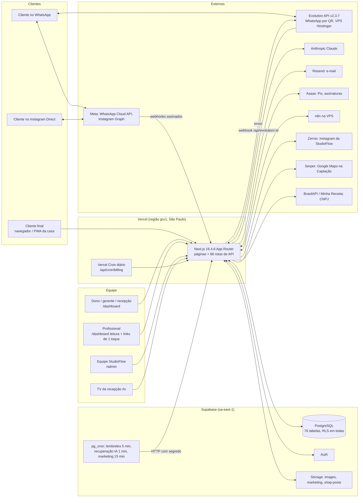
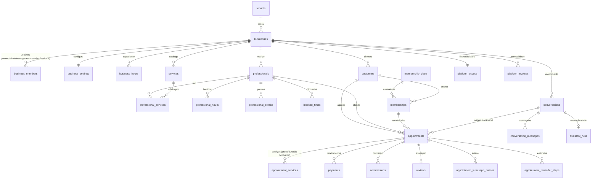
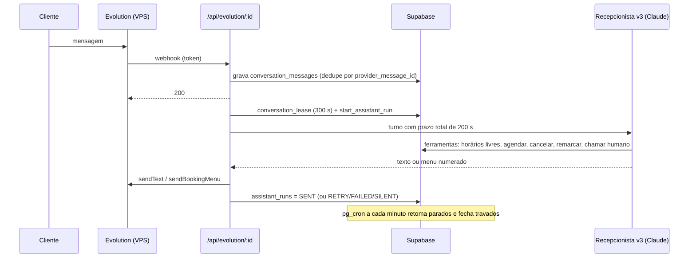

# StudioFlow: arquitetura, banco de dados e infraestrutura

Auditoria de 25/11/2026, feita no código-fonte (commit `dc1ff6f`, branch `main` do repositório `mh0097317-ai/studioflow`), no banco de produção (Supabase, somente leitura e números agregados) e na configuração da Vercel (só nomes das variáveis, nenhum valor lido).

---

## 1. Visão geral



- **O app é um monólito Next.js.** A mesma base de código serve o site de vendas, a página pública e o agendamento de cada barbearia, o painel do estabelecimento, o painel da plataforma (`/admin`), os webhooks e os jobs.
- **Multiempresa.** Cada tabela de negócio carrega `business_id` (e, nas principais, `tenant_id`). O isolamento é feito em duas camadas: o servidor confere o vínculo do usuário, e o banco aplica RLS e chaves estrangeiras compostas.
- **Modo demonstração.** Sem as variáveis do Supabase, o app usa dados fictícios (`src/lib/seed.ts`) persistidos em `.data/` por estabelecimento. A demo `barber-011` é a usada nos testes e capturas. Em produção esse modo fica bloqueado: o `proxy.ts` redireciona `/dashboard`, `/tv` e `/admin` para o login.

## 2. Stack tecnológica

| Camada | Tecnologia (versão fixada no `package.json`) |
| --- | --- |
| Framework | Next.js **16.4.6** (App Router, build com Webpack), React 19.3.0, TypeScript 6.0.3 |
| Estilo | Tailwind CSS 4.3.3 (pouco usado), CSS próprio por módulo (~33 mil linhas), fontes locais Fraunces + Hanken Grotesk (OFL) |
| Ícones | `@phosphor-icons/react` 2.1.10 (Lucide ainda instalado, sem uso nas telas) |
| Formulários | react-hook-form 7.89, zod 4.6.7 |
| Banco / Auth | Supabase (`@supabase/ssr` 0.12.7, `supabase-js` 2.117.2), PostgreSQL 17 gerenciado |
| IA | `@anthropic-ai/sdk` ^0.131.0 |
| 3D | three.js 0.186 (Salão ao vivo em 3D) |
| Mídia | sharp, ffmpeg-static (Reels do Marketing), pdf-lib (relatórios em PDF), qrcode |
| Testes | `node:test` via `tsx --test` e PGlite 0.5.8 (PostgreSQL real em WebAssembly para migrações, RLS e RPCs) |

**Tamanho:** cerca de 78,7 mil linhas TS/TSX e 33 mil linhas de CSS; 29 páginas, 86 rotas de API, 63 migrações, 108 arquivos de teste.

## 3. Organização do código

```text
src/app/          Rotas: páginas, APIs (route.ts), auth, PWA por estabelecimento
src/components/   UI compartilhada (ui.tsx, modal, calendário, upload, marca, motion)
src/features/     Telas por área: agenda, booking, dashboard, landing, management,
                  platform (/admin), public, tv, attendance, legal
src/hooks/        use-workspace (estado do painel), use-permissions, use-conversations
src/lib/          Regras puras e testáveis: disponibilidade, módulos, acesso, seed,
                  inbox, métricas, relatórios, telefone, datas
src/services/     Somente servidor: server-store (acesso a dados), assistant/ (IA),
                  whatsapp/, payments/, email/, marketing/, leads/, cofre, billing
src/types/        Contratos (Store, Appointment, Settings, etc.)
supabase/         63 migrações + seed
tests/            108 arquivos (domínio, PGlite, RLS, concorrência, IA com modelo simulado)
ops/              Evolution API (Docker/Caddy, Render) e patch de listas nativas
scripts/          smoke HTTP e gerador de seed
docs/             Documentos técnicos e capturas antigas
```

### Frontend
- **O painel é um app cliente** que carrega o "workspace" inteiro (`GET /api/workspace`, tipo `Store`) num contexto React (`use-workspace.tsx`). As mutações passam por `mutate(entity, action, data)` → `/api/workspace`, que chama a RPC `workspace_mutation`.
- **Páginas públicas** (`/[slug]`, `/[slug]/agendar`) recebem o catálogo renderizado no servidor (`public-catalog.ts`, cache de 15 s na CDN). As etapas do agendamento montam no navegador.
- **Telas com dados ao vivo** (Conversas, faixa "Precisa de você", contador do menu) usam um polling compartilhado (`use-conversations.ts`): conversas a cada 60 s, operação a cada 5 min.

### Backend
- Rotas `route.ts` finas, com validação zod em `server-validation.ts`. Erros de domínio (`DomainError`) viram status HTTP coerentes (`server-http.ts`).
- O acesso a dados usa o cliente Supabase com a sessão do usuário (RLS) ou o cliente admin (`service_role`) nas operações de servidor (webhooks, cron, IA, auditoria).
- Trabalho depois da resposta com `after()` (avisos ao profissional, resposta da IA, auditoria).
- **Workers e filas:** não há fila dedicada (sem Redis, SQS ou BullMQ). A fila é o próprio banco:
  - claims atômicos (`claim_appointment_notice`, `claim_email_notice`, `claim_staged_appointment_reminder`, `claim_marketing_post`);
  - lease por conversa (`conversation_lease`);
  - estados de execução (`assistant_runs`);
  - jobs disparados pelo `pg_cron` que chamam rotas HTTP do app com segredo.

## 4. Banco de dados

**Produção:** projeto Supabase `dyukaebjntbfeqctyehi`, região `sa-east-1`. **63 migrações** aplicadas.

| Objeto | Quantidade |
| --- | --- |
| Tabelas em `public` | 76, **todas com RLS** |
| Funções | 51 em `public` (RPCs) e 14 em `private` |
| Triggers | 64 (`touch_updated_at`, `preserve_scope`, perfis) |

### 4.1 Tabelas por domínio

| Domínio | Tabelas |
| --- | --- |
| Núcleo multiempresa | `tenants`, `businesses`, `business_members`, `profiles`, `business_settings`, `business_hours` |
| Equipe | `professionals`, `professional_hours`, `professional_breaks`, `professional_services`, `professional_access_invites`, `professional_whatsapp_links` |
| Catálogo | `services`, `products` |
| Agenda | `appointments`, `appointment_services`, `blocked_times`, `waitlist` |
| CRM | `customers`, `reviews`, `customer_winbacks`, `whatsapp_contacts` |
| Financeiro | `payments`, `commissions`, `product_sales`, `payment_accounts` (Asaas da loja, cifrado), `membership_plans`, `memberships` |
| Avisos | `appointment_whatsapp_notices`, `appointment_reminder_steps`, `appointment_email_notices`, `owner_email_notices`, `n8n_notification_receipts`, `weekly_report_deliveries`, `weekly_report_preferences` |
| Recepcionista IA | `conversations`, `conversation_messages`, `assistant_runs`, `assistant_usage`, `assistant_alerts`, `assistant_eval_runs`, `business_ai_credentials` (cofre), `business_ai_plan`, `business_transcription_credentials` |
| Canais | `whatsapp_links` (Evolution), `whatsapp_accounts` (Meta Cloud), `instagram_accounts`, `instagram_feeds`, `shop_instagram_posts` |
| Plataforma (/admin) | `platform_admins`, `platform_access`, `platform_access_events`, `platform_invoices`, `platform_manual_invoices`, `platform_billing_notices`, `platform_integrations` (cofre), `platform_settings`, `platform_ai_control`, `platform_channel_events`, `platform_config_events`, `platform_email_log`, `platform_email_settings`, `platform_voice_credentials`, `platform_weekly_report_*` |
| Captação e Marketing da StudioFlow | `platform_leads`, `platform_lead_events`, `platform_lead_settings`, `marketing_account`, `marketing_posts`, `marketing_video_jobs` |
| Auditoria e erros | `activity_log`, `page_events`, `app_errors` |

### 4.2 Relacionamentos principais



### 4.3 Onde cada informação fica

| Informação | Onde |
| --- | --- |
| Usuários e senhas | Supabase Auth (`auth.users`); perfil em `profiles`; vínculo e papel em `business_members` |
| Admins da plataforma | `platform_admins` (só servidor) |
| Dados da casa, identidade, fotos | `businesses` (URLs de imagem; arquivos no bucket `images`) |
| Regras de agenda | `business_settings` (antecedência mínima, dias máximos, intervalo, política de cancelamento, sinal), `business_hours`, `professional_hours`, `professional_breaks`, `blocked_times` |
| Agendamentos | `appointments` (+ `appointment_services` com preço e duração do momento da reserva) |
| Clientes | `customers` (nome, telefone, e-mail opcional, consentimento de lembrete) |
| Dinheiro | `payments` (recebimentos), `product_sales`, `commissions`, `memberships` |
| Chaves de terceiros | Cifradas com AES-256-GCM (`server-secrets.ts`): `business_ai_credentials`, `payment_accounts`, `whatsapp_accounts`, `instagram_*`, `platform_integrations`, `platform_voice_credentials`. A chave de cifra é `PAYMENTS_ENCRYPTION_KEY` ou, sem ela, derivada da chave secreta do Supabase |
| Tokens públicos (comprovante, clube, convites, webhooks) | Só o hash SHA-256 fica no banco; o token tem 256 bits |
| Conversas e mensagens | `conversations`, `conversation_messages`; o espelho do histórico real vem da Evolution |
| Uso da IA | `assistant_usage` (turnos e tokens por dia) |
| Fotos | Storage: `images` (47 objetos), `marketing` (12), `shop-posts`. Os três buckets são públicos para leitura; a escrita é só pelo servidor (não há políticas em `storage.objects`) |
| Auditoria | `activity_log` (ações da equipe e do cliente), `page_events` (funil da página, sem dados pessoais) |

### 4.4 Funções (RPC) relevantes

- **Agenda:** `book_appointment`, `book_public_appointment`, `book_tracked_appointment`, `manage_booking`, `get_booking`, `hold_for_deposit`, `confirm_deposit`, `expire_deposit_holds`, `apply_membership`, `workspace_mutation`, `create_workspace`, `check_in_by_token`, `check_in_by_phone`, `settle_attendance`, `submit_review`.
- **Avisos:**
  - lembretes e notificações: `due_staged_appointment_reminders`, `claim_staged_appointment_reminder`, `due_professional_booking_notices`, `claim_appointment_notice`;
  - e-mail: `due_email_notices`, `claim_email_notice`;
  - atendimento e dono: `due_attendance_checks`, `due_unsettled_owner_alerts`.
- **IA:** `conversation_lease`, `start_assistant_run`, `assistant_take_turn`, `assistant_add_tokens`, `assistant_manage_booking`, `assistant_health`, `assistant_waiting_customers`, `due_assistant_conversations`, `stale_assistant_runs`, `request_assistant_analysis`.
- **Plataforma:** `platform_overview`, `platform_set_access`, `platform_set_plan`, `platform_set_channel`, `platform_invoice_paid`, `platform_manual_billing`, `platform_save_ai_key`, `platform_save_evolution`, `platform_save_assistant`, `platform_save_voice_credential`, `platform_activity`, `verify_appointment_scheduler`.
- **Privadas:** `customer_busy` (trava do mesmo cliente), `slot_available`, `expire_holds`, `member_role`, `can_access_professional`, `membership_usage`.

**Proteção contra conflito de horário:**
- `book_appointment` trabalha sob advisory lock por profissional;
- revalida o intervalo inteiro (duração, intervalo, expediente, pausas, bloqueios, folgas);
- há uma *exclusion constraint* GiST em `appointments`;
- a função privada `customer_busy` impede o mesmo telefone em dois horários sobrepostos.

### 4.5 RLS e papéis
- **Papéis do estabelecimento:** `owner`, `admin`, `manager`, `reception`, `professional`.
- **O que cada papel faz:**
  - `professional` é somente leitura, e no painel enxerga só as telas permitidas;
  - catálogo, equipe, negócio, configurações e pagamentos exigem owner, admin ou manager (`permissions.ts`, espelhado em `workspace_mutation`).
- **Tabelas de membros:** a RLS libera leitura a quem é membro da empresa.
- **Tabelas só do servidor:** 47 tabelas têm RLS sem políticas, e só o `service_role` acessa. O aviso do Supabase sobre elas é intencional.
- **RPCs críticas** têm `revoke` para `anon` e `authenticated` e `grant` só para `service_role`.

## 5. APIs (86 rotas)

| Grupo | Rotas | Autenticação |
| --- | --- | --- |
| Público por casa | `/api/public/[slug]` e `/availability`, `/slots`, `/next-free`, `/book`, `/chat`, `/checkin`, `/club`, `/club/[token]`, `/waitlist`, `/instagram`, `/track` | Anônimo, com projeção explícita (sem CRM nem financeiro), rate limit em memória e teto de 4 reservas futuras por telefone |
| Comprovante | `/api/booking/[token]`, `/deposit`; `/api/attendance/[token]` | Token de 256 bits (hash no banco) ou link assinado de 48 h |
| Painel | `/api/workspace` e 35 sub-rotas (assistant, conversations, payments, plans, products, reports, whatsapp-link, billing…) | Sessão Supabase + vínculo no servidor (`requireMembership`) + módulo do plano (`requireModule`) |
| Cadastro | `/api/signup`, `/api/onboarding`, `/api/professional-invites`, `/auth/callback`, `/auth/logout` | Supabase Auth |
| Plataforma | `/api/admin/*` (20 rotas) | Login próprio do /admin + tabela `platform_admins` (checado no `proxy.ts` e na rota) |
| Webhooks | `/api/evolution/[businessId]?token=`, `/api/whatsapp/[businessId]` (Meta), `/api/instagram/[businessId]`, `/api/payments/asaas/[businessId]`, `/api/billing/asaas` | Token com hash no banco; assinatura `X-Hub-Signature-256` (Meta); cabeçalho `asaas-access-token` |
| n8n | `/api/integrations/n8n/consultar`, `/candidatos`, `/notificar` | Cabeçalho `x-studioflow-integration-token` (hash em `N8N_INTEGRATIONS`) |
| Jobs | `/api/cron/appointments`, `/assistant`, `/marketing` (pg_cron); `/api/cron/billing` (Vercel Cron) | Segredo de 64 hex conferido pela RPC `verify_appointment_scheduler`; billing exige `CRON_SECRET` |
| Mídia | `/api/marketing/image/[id]/[slide]`, `/[slug]/manifest.webmanifest`, `/[slug]/app-icon/*`, `/api/uploads` | Público ou sessão |

## 6. Jobs agendados (produção, conferido no banco)

| Job | Frequência | O que faz |
| --- | --- | --- |
| `studioflow-appointment-reminders` (pg_cron → `/api/cron/appointments`) | 5 min | Lembretes 12h, 2h e 1h; avisos ao profissional; e-mails; checagem "atendeu?"; alerta de atendimento sem baixa ao dono; relatórios diário e semanal; relatório semanal da plataforma; PDF semanal por e-mail (segunda, 9h); saúde da recepcionista e reconexão do WhatsApp; avaliação noturna; mensagem de retorno às 10h; agenda das casas de demonstração; limpeza de erros com mais de 30 dias |
| `studioflow-assistant-recovery` (pg_cron → `/api/cron/assistant`) | 1 min | Retoma conversas paradas e fecha execuções travadas |
| `studioflow-marketing` (pg_cron → `/api/cron/marketing`) | 15 min | Publica posts agendados e coleta métricas |
| Vercel Cron `/api/cron/billing` | Diário, 12:00 UTC | Lembretes de mensalidade, renovação dos tokens do Instagram, e-mails de boas-vindas. **Hoje não roda**: `CRON_SECRET` não está definido na Vercel, e a rota recusa (401) sem ele |

## 7. Autenticação e sessões
- **Painel:** Supabase Auth por e-mail e senha, com o fluxo SSR oficial (`@supabase/ssr`, cookies). Há recuperação de senha em `/login/nova-senha` e convite de profissional por link (`/equipe/convite/[token]`).
- **/admin:** login separado (`/admin/login`, cliente `platform-auth`), autorizado pela tabela `platform_admins`.
- **Cliente final:** não tem conta. A identidade é o telefone, e o acesso ao próprio agendamento é pelo token do comprovante. O aparelho lembra o cliente em `localStorage`.
- **Bloqueio por acesso:** sem acesso liberado ou fora do prazo, o servidor fecha painel, APIs, agenda online, chat, clube, lista de espera, check-in e canais, com status 423 (`src/lib/access.ts`).

## 8. Variáveis de ambiente (só nomes)

**Definidas na Vercel (produção):**
- `NEXT_PUBLIC_SUPABASE_URL`, `NEXT_PUBLIC_SUPABASE_PUBLISHABLE_KEY`, `SUPABASE_SECRET_KEY`;
- `RESEND_API_KEY`, `ZERNIO_API_KEY`, `STUDIOFLOW_ASSISTANT_ENGINE` (=`v3`);
- `N8N_BOOKING_EVENTS`, `N8N_WHATSAPP`, `N8N_INTEGRATIONS`;
- `NARRATION_TOKEN`, que é uma sobra temporária: a rota que a usava foi removida.

**Lidas pelo código e ausentes na Vercel** (algumas têm alternativa no cofre do banco):

| Variável | Efeito da ausência |
| --- | --- |
| `CRON_SECRET` | **Job diário de cobrança/Instagram/boas-vindas parado** |
| `ANTHROPIC_API_KEY` / `ANTHROPIC_AUTH_TOKEN` | IA só funciona para lojas com chave no cofre (`business_ai_credentials`, 1 cadastrada) |
| `EVOLUTION_API_URL` / `EVOLUTION_API_KEY` | Vêm do cofre `platform_integrations` (configurado) |
| `STUDIOFLOW_ASAAS_API_KEY`, `STUDIOFLOW_ASAAS_ENV`, `STUDIOFLOW_ASAAS_WEBHOOK_TOKEN` | Mensalidade automática pelo Asaas desligada (há cobrança manual) |
| `NEXT_PUBLIC_STUDIOFLOW_WHATSAPP` | Botões "Falar com o StudioFlow" e "Avisar o StudioFlow" somem |
| `NEXT_PUBLIC_SALES_WHATSAPP`, `NEXT_PUBLIC_SUPPORT_EMAIL`, `NEXT_PUBLIC_APP_URL` | Usam padrão (`app.studioflowapp.tech`, `contato@studioflowapp.tech`) |
| `PAYMENTS_ENCRYPTION_KEY` | Cifra derivada da chave secreta do Supabase (trocar a chave do Supabase obriga a reconectar todas as contas) |
| `TRANSCRIBE_API_KEY`, `TRANSCRIBE_BASE_URL`, `TRANSCRIBE_MODEL` | Áudio só vira texto se houver credencial no cofre por loja |
| `EMAIL_FROM` | Padrão `StudioFlow <avisos@studioflowapp.tech>` |
| `STUDIOFLOW_RECEPTIONIST_MODEL`, `STUDIOFLOW_ASSISTANT_MODEL`, `STUDIOFLOW_MARKETING_MODEL` | Padrões: `claude-sonnet-5-5`, `claude-haiku-4-5`, `claude-opus-5-5` |
| `STUDIOFLOW_MARKETING_ANTHROPIC_KEY`, `STUDIOFLOW_MARKETING_GEMINI_KEY`, `ELEVENLABS_API_KEY`, `ELEVENLABS_VOICE_ID`, `SERPER_API_KEY` | Podem estar no cofre do /admin |
| `STUDIOFLOW_WHATSAPP_NATIVE_LISTS` | Listas nativas desligadas (Evolution 2.3.7 recusou com HTTP 400) |
| `STUDIOFLOW_NIGHTLY_EVAL`, `STUDIOFLOW_DEMO_MODE`, `ATTENDANCE_LINK_SECRET` | Opcionais |

## 9. Infraestrutura

| Item | Situação |
| --- | --- |
| Aplicação | Vercel, projeto `studioflow` (`prj_Efw3ALVgEjyXIpGrblaeV1WWiW6m`), região `gru1` |
| Endereço | **https://app.studioflowapp.tech** (domínio de produção). Domínio raiz `studioflowapp.tech` com DNS pendente segundo o histórico |
| Repositório | GitHub `mh0097317-ai/studioflow`, branch `main` (11 commits, de 01/11 a 24/11/2026). Histórico anterior no espelho `mh0097317-ai/agrogestor`, pasta `studioflow/`, branch `claude/barbershop-scheduling-platform-0jnoui` (124 commits do StudioFlow desde 03/10/2026) |
| Último commit | `dc1ff6f` (24/11/2026): "Início mostra o que precisa do dono e a agenda conclui já cobrando". Deploy `dpl_6QvK22h7EikP3qTKpwD68wwo3biF`, READY |
| Deploy | Automático a cada push em `main` (integração Git da Vercel) |
| CI | `.github/workflows/ci.yml`: lint, tipos e testes a cada push e PR |
| Banco | Supabase `dyukaebjntbfeqctyehi` (sa-east-1). Backups: os do plano Supabase. Não há rotina própria documentada nem restauração testada |
| WhatsApp (Evolution) | VPS Hostinger com Docker (Evolution 2.3.7, n8n, Postgres, Redis, proxy). Arquivos em `ops/evolution/`. As pendências de backup, monitoramento e firewall estão listadas em `VPS-PARA-O-CODEX.md` (raiz do repositório agrogestor). Existe ainda um blueprint Render gratuito antigo (`render.yaml`); o healthcheck dele já foi removido do banco |
| Ambientes | Produção (Vercel + Supabase); Preview da Vercel (mesmas chaves do Supabase de produção: não há banco de homologação); Desenvolvimento local em modo demonstração. **Não há homologação separada** |
| Monitoramento | Interno: `app_errors`, `/dashboard/operacao`, `/admin` (Operação/Histórico), alertas ao dono (WhatsApp/e-mail). Externo: nenhum (o Uptime Kuma está proposto, não instalado) |
| Custos conhecidos | Não há dados de fatura no repositório nem no banco. Itens com custo variável: Vercel, Supabase, VPS Hostinger, tokens da Anthropic (por loja ou da plataforma), Resend, Zernio, Serper, Asaas (taxas por transação), Meta (conversas da Cloud API) |

## 10. Diagrama do fluxo de uma mensagem no WhatsApp


